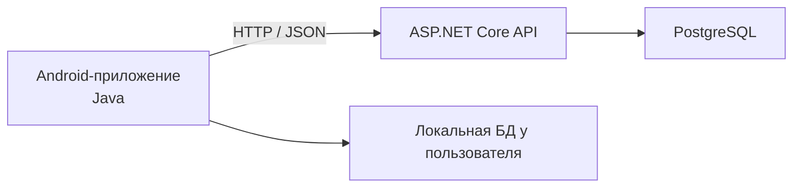

Клиент хранит заметки локально в SQLite/Room, чтобы работать офлайн.
При появлении интернета клиент синхронизирует изменения с сервером.
Сервер — главный источник данных, которые синхронизированы. Локальные несинхронизированные изменения живут только на устройстве.

Сервер работает на ASP.NET Core с подключенной PostrgeSQL.
Общение между клиентом и сервером идет по http согласно rest api.

## Changelog

| Дата | Изменение |
|------|-----------|
| 2026-10-29 | Первая версия документации |